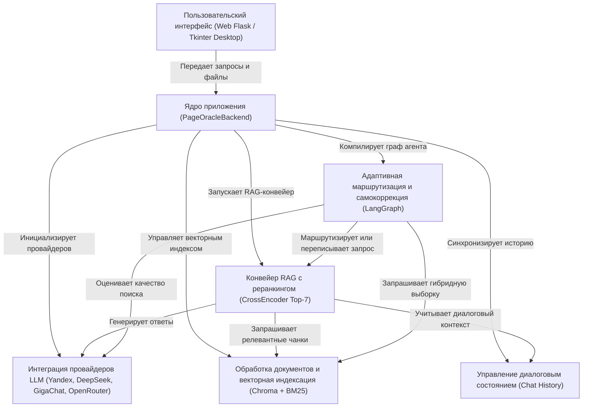

# 📖 PageOracle: Мудрость в каждой странице

📖 **PageOracle** — интеллектуальная программная система для анализа и умного поиска информации по книгам (`.txt`) на базе Retrieval-Augmented Generation (RAG) и адаптивных графов агентов. Приложение оснащено как современным веб-интерфейсом (Flask, HTML5, CSS3, JS), так и десктопным интерфейсом (Tkinter). PageOracle выполняет синтаксическую разметку текста по главам, индексирует материалы в векторном хранилище, производит гибридный поиск (Chroma MMR/Similarity + BM25) с нейросетевым реранкингом (CrossEncoder) и формулирует точные аналитические ответы с прямыми цитатами и источниками.

<div align="center">

## 🛠️ Стек технологий и архитектура

<!-- Core & AI Pipeline -->
[](https://www.python.org/)
[](https://www.langchain.com/)
[](https://langchain-ai.github.io/langgraph/)
[](https://www.trychroma.com/)
[](https://pytorch.org/)
[](https://huggingface.co/)

<!-- UI & Frontends -->
[](https://flask.palletsprojects.com/)
[](https://docs.python.org/3/library/tkinter.html)
[](https://developer.mozilla.org/ru/docs/Web/HTML)
[](https://developer.mozilla.org/ru/docs/Web/CSS)
[](https://developer.mozilla.org/ru/docs/Web/JavaScript)

<!-- Supported Providers -->
[](https://yandex.cloud/ru/services/yandexgpt)
[](https://developers.sber.ru/portal/products/gigachat)
[](https://openrouter.ai/)
[](https://www.deepseek.com/)
[](https://openai.com/)

<!-- Tooling & Releases -->
[](https://www.microsoft.com/windows)
[](https://astral.sh/ruff)
[](https://git-scm.com/)
[](https://github.com/mrzolz19/pageoracle/releases)

</div>

> [!NOTE]
>
> ### 🏆 Международный хакатон «Технострелка 2026» — Финалист отборочного этапа
>
> Проект разработан для отборочного этапа Международного хакатона **[«Технострелка» 2026](https://tehnostrelka52.ru/)** по направлению **«ИСКУССТВЕННЫЙ ИНТЕЛЛЕКТ»** (Кейс: *«Умный поиск по книгам»*).
> 
> По результатам экспертной оценки жюри решение **успешно прошло отборочный этап и вышло в финал турнира**. Поездка команды на очный финал не состоялась исключительно по не зависящим от участников финансовым причинам направляющей организации.
> 
> 📌 **Конкурсная версия:** Последний зафиксированный коммит, отправленный на оценку жюри хакатона: [`5cadd17`](https://github.com/mrzolz19/pageoracle/commit/5cadd17739d70fdfc721a09a4e54c19a50024c44) *(от 25 марта 2026 г.)*.

> [!TIP]
>
> ### 🚀 Текущий статус проекта
>
> На данный момент проект находится в фазе **активного развития и полировки**: автор доводит функционал, архитектуру RAG-пайплайна, дизайн интерфейсов, документацию и общую производительность до идеального состояния, каким проект хотел бы автор видеть изначально.

---

## ✨ Визуальный обзор: как работает система



---

## 📄 Содержание

- [Глава I. Работа с PageOracle](#-глава-i-работа-с-pageoracle)
  - [1. Быстрый запуск для Windows (без Python)](#-быстрый-запуск-для-windows-без-установки-python)
  - [2. Запуск из исходного кода (для разработчиков)](#-запуск-из-исходного-кода-для-разработчиков)
  - [3. Настройка провайдеров и моделей](#-настройка-провайдеров-и-моделей)
  - [4. Пользовательский интерфейс (GUI)](#-пользовательский-интерфейс-gui)
  - [5. Примеры работы](#-примеры-работы)
  - [6. Мини-чеклист, если ответ не устраивает](#-мини-чеклист-если-ответ-не-устраивает)
  - [7. Диагностика и решение ошибок](#-диагностика-и-решение-ошибок)
- [Глава II. Как устроен PageOracle](#️-глава-ii-как-устроен-pageoracle)
  - [1. Краткий обзор работы по шагам](#1-краткий-обзор-работы-по-шагам)
  - [2. Обработка и индексирование документов](#2-обработка-и-индексирование-документов)
  - [3. Архитектура ядра PageOracleBackend](#3-архитектура-ядра-pageoraclebackend)
  - [4. Мультипровайдерность LLM](#4-мультипровайдерность-llm)
  - [5. Управление историей диалога](#5-управление-историей-диалога)
  - [6. Гибридный поиск и Re-ranking](#6-гибридный-поиск-и-re-ranking)
  - [7. Адаптивный ИИ-агент на LangGraph](#7-адаптивный-ии-агент-на-langgraph)

---

## 🚀 Глава I. Работа с PageOracle

### ⚡ Быстрый запуск для Windows (без установки Python)

> [!TIP]
> **Автономный запуск в один клик:** Если вам нужно готовое приложение без установки Python, Git и настройки виртуальных сред, скачайте готовую сборку из [GitHub Releases](https://github.com/mrzolz19/pageoracle/releases).

1. **Скачайте подходящий архив**:
   - `PageOracle-windows-x64-cpu.zip` (~850 МБ) — универсальная сборка, стабильно работающая на любых ПК с Windows 10/11 x64 без видеокарты NVIDIA.
   - `PageOracle-windows-x64-cu128.zip` (~2.3 ГБ) — ускоренная сборка с аппаратной поддержкой PyTorch CUDA 12.8 для систем с дискретными видеокартами NVIDIA GeForce RTX / GTX. (не выкладывается в Releases из-за большого размера, можно скачать из Actions)
2. **Распакуйте архив**:
   Распакуйте архив в любую удобную папку (например, `C:\PageOracle` или на рабочий стол).
3. **Структура папки релиза**:
   - `PageOracle.exe` — запуск приложения.
   - `books/` — библиотека книг в формате `.txt`. Базовые книги уже включены в архив; вы можете свободно добавлять новые файлы.
   - `settings.json` — конфигурация (провайдеры, ключи API, параметры генерации), сохраняется автоматически.
4. **Запуск**:
   Запустите `PageOracle.exe` двойным кликом.

---

### 💻 Запуск из исходного кода (для разработчиков)

1. **Клонируйте репозиторий и перейдите в папку проекта**:

   ```bash
   git clone https://github.com/mrzolz19/pageoracle.git
   cd pageoracle
   ```

2. **Выберите желаемый интерфейс**:
   - Для **веб-интерфейса** (Flask Web UI):

     ```bash
     cd web_gui_pageoracle
     pip install -r requirements.txt
     python gui.py
     ```

     После старта откройте в браузере: <http://127.0.0.1:5000>
   - Для **классического десктопного интерфейса** (Tkinter Desktop GUI):

     ```bash
     cd tkinter_gui
     pip install -r requirements.txt
     python gui.py
     ```

> [!IMPORTANT]
> **Требования к среде:** Требуется **Python 3.10+**. Рекомендуется использовать виртуальное окружение (`python -m venv venv`). При установке зависимостей с CUDA PyTorch используйте параметры из `requirements.txt`.

---

### ⚙️ Настройка провайдеров и моделей

При первом запуске откройте панель настроек для конфигурации доступа к моделям:

<p align="center">
  
  
</p>

1. **Провайдер ИИ:**
   - **YandexGPT** *(рекомендуется по умолчанию для текстов на русском языке)*
   - **OpenRouter** *(универсальный шлюз к сотням открытых и проприетарных моделей)*
   - **DeepSeek**, **Sber GigaChat**, **OpenAI**, **Anthropic**, **Google**.
2. **LLM Модель:**
   - Для Yandex: `yandexgpt-5.1/latest`
   - Для других провайдеров: `deepseek-chat`, `gpt-4o` / `gpt-5.4`, `gigachat-2` и др.
3. **Embedding-модель:**
   - `text-search-doc` (Yandex Cloud)
   - `nvidia/llama-nemotron-embed-vl-1b-v2:free` (OpenRouter, онлайн, бесплатно)
   - `BAAI/bge-m3` (локальная модель без обращения к внешним API).
4. **API Ключи:**
   - Вставьте API-ключ выбранного сервиса: [OpenRouter](https://openrouter.ai/workspaces/default/keys), [GigaChat](https://developers.sber.ru/studio/workspaces/), [DeepSeek](https://platform.deepseek.com/api_keys), [Google AI Studio](https://aistudio.google.com/app/api-keys), [OpenAI](https://platform.openai.com/), [Anthropic](https://platform.claude.com/), [Yandex Cloud](https://aistudio.yandex.ru/platform).

> [!IMPORTANT]
> **Обязательно для Yandex Cloud:** При работе с YandexGPT помимо `YC_API_KEY` требуется указать идентификатор каталога (**`YC_FOLDER_ID`**). Инструкция по получению доступна [в официальной документации Yandex Cloud](https://yandex.cloud/ru/docs/resource-manager/operations/folder/get-id).

5. **Режимы работы:**
   - **«Авто»**: Агент анализирует запрос и автономно выбирает между аналитикой и точным цитированием.
   - **«Анализ»**: Формирует структурированный ответ с выводами, контекстом и фактологией.
   - **«Поиск цитат»**: Ищет точные словесные фрагменты текста с указанием точного источника (книга, часть, глава).

<p align="center">
  
</p>

---

### 🖥️ Пользовательский интерфейс (GUI)

В системе реализованы два полноценных независимых графических клиента:

<p align="center">
  
  
</p>

- **Web GUI (Flask + HTML/CSS/JS):**
  - Централизованное управление состоянием через потокобезопасный `WebAppState` с защитой через `RLock` и `operation_lock`.
  - Полнофункциональный REST API: `/api/state`, `/api/init`, `/api/upload`, `/api/chat`, `/api/settings`, `/api/mode`.
  - Монитор логов и статусов индексации в реальном времени.
- **Desktop GUI (Tkinter):**
  - Полностью автономное нативное окно без браузера.
  - Удобная боковая панель библиотеки, история сессий и всплывающие диалоговые окна настроек (`Toplevel`).

---

### 💡 Примеры работы

<details open>
<summary><b>🔍 Поиск точных цитат — Пример 1: «Цветы Маргариты» (М. Булгаков)</b></summary>
<br>

**🧑 Запрос пользователя:**
> *Найди где говорится про то какие цветы у Маргариты, когда она встретила мастера*

**🤖 Ответ PageOracle:**
> На основе предоставленного контекста найдена точная цитата, отвечающая на запрос о цветах у Маргариты при встрече с Мастером:
> 
> *«Она несла в руках отвратительные, тревожные желтые цветы. Черт их знает, как их зовут, но они первые почему-то появляются в Москве. И эти цветы очень отчетливо выделялись на черном ее весеннем пальто. Она несла желтые цветы! Нехороший цвет.»*  
> *(«Булгаков Михаил. Мастер и Маргарита», Часть 1, Глава 13).*
> 
> Этот фрагмент является прямым описанием Мастером их первой встречи, где он подробно вспоминает, что Маргарита держала в руках желтые цветы.

<p align="center">
  
</p>
</details>

<details>
<summary><b>🔍 Поиск точных цитат — Пример 2: «Описание Сони Мармеладовой» (Ф. Достоевский)</b></summary>
<br>

**🧑 Запрос пользователя:**
> *Найди фрагменты где описывается Соня Мармеладова, её внешность, черты характера*

**🤖 Ответ PageOracle:**
> 1. *«Соня была малого роста, лет восемнадцати, худенькая, но довольно хорошенькая блондинка, с замечательными голубыми глазами.»* («Преступление и наказание», Часть 2, Глава 7).
> 2. *«Соня проговорила это точно в отчаянии, волнуясь и страдая, и ломая руки. Бледные щеки ее опять вспыхнули, в глазах выразилась мука... Какое-то ненасытимое сострадание, если можно так выразиться, изобразилось вдруг во всех чертах лица ее.»* («Преступление и наказание», Часть 4, Глава 4).
> 3. *«Она чистая. Она так верит, что во всем справедливость должна быть, и требует… И хоть мучайте ее, а она несправедливого не сделает...»* («Преступление и наказание», Часть 4, Глава 4).

<p align="center">
  
</p>
</details>

<details>
<summary><b>🔍 Поиск точных цитат — Пример 3: Завершение фразы («Преступление и наказание»)</b></summary>
<br>

**🧑 Запрос пользователя:**
> *Найди фрагмент текста где говорится примерно так: "тварь ли я дрожащая или..." и допиши его*

**🤖 Ответ PageOracle:**
> *«Мне другое надо было узнать, другое толкало меня под руки: мне надо было узнать тогда, и поскорей узнать, вошь ли я, как все, или человек? Смогу ли я переступить или не смогу! Осмелюсь ли нагнуться и взять или нет? Тварь ли я дрожащая или право имею…»*  
> *(«Преступление и наказание», Часть 5, Глава 4)*

<p align="center">
  
</p>
</details>

<details>
<summary><b>📊 Аналитический запрос — Пример 1: «Наташа и Пьер в эпилоге» (Л. Толстой)</b></summary>
<br>

**🧑 Запрос пользователя:**
> *Что произошло с Наташей и Пьером в эпилоге романа "Война и мир"?*

**🤖 Ответ PageOracle:**
> **Цитаты из текста:**  
> • *«Свадьба Наташи, вышедшей в 13-м году за Безухова, было последнее радостное событие в старой семье Ростовых.»* (Часть 1, Глава 5)  
> • *«В обществе молодую графиню Безухову видели мало... она, нося, рожая, кормя детей и принимая участие в каждой минуте жизни мужа, не могла удовлетворить этим потребностям иначе, как отказавшись от света.»* (Часть 1, Глава 10)  
> 
> **Анализ:**  
> В эпилоге романа Наташа Ростова и Пьер Безухов состоят в счастливом браке, заключённом в 1813 году. Наташа полностью посвятила себя семейной жизни и детям, сознательно отойдя от светских раутов. Между супругами установилось глубокое взаимопонимание, в котором частный семейный мир стал для обоих источником гармонии.

<p align="center">
  
</p>
</details>

<details>
<summary><b>📊 Аналитический запрос — Пример 2: «Теория Раскольникова» (Ф. Достоевский)</b></summary>
<br>

**🧑 Запрос пользователя:**
> *Расскажи о поиске истины Раскольниковым. В чем суть его теории?*

**🤖 Ответ PageOracle:**
> **Цитаты из текста:**  
> • *«Всё дело в том, что в ихней статье все люди как-то разделяются на «обыкновенных» и «необыкновенных»... А необыкновенные имеют право делать всякие преступления и всячески преступать закон...»* (Часть 3, Глава 5)  
> 
> **Анализ:**  
> Поиск истины Раскольникова — путь от рационалистической гордыни и теории об «избранных властелинах судьбы» к осознанию её нравственного банкротства. Преступление являлось жестоким экспериментом для самопроверки («Вошь ли я, как все, или человек?»). Истинное раскаяние и освобождение герой находит через признание вины перед людьми и веру, воплощенную Соней.

<p align="center">
  
</p>
</details>

---

### 📋 Мини-чеклист, если ответ не устраивает

> [!TIP]
>
> 1. **Переключите режим:** Для дословных совпадений используйте принудительный режим *«Поиск цитат»*.
> 2. **Смените модель:** Переключитесь на более крупную LLM (например, `yandexgpt-5.1` или флагманские модели через OpenRouter).
> 3. **Сузьте контекст:** Укажите имя персонажа, ключевой эпизод, конкретную часть или главу.
> 4. **Избегайте местоимений:** Вместо *«Что с ним стало?»* пишите *«Что произошло с Пьером Безуховым в эпилоге?»*.
> 5. **Очистите историю:** Нажмите *«Очистить историю»*, чтобы убрать устаревший контекст предыдущих реплик.

---

### 🛠️ Диагностика и решение ошибок

| Симптом | Вероятная причина | Решение |
| :--- | :--- | :--- |
| `ModuleNotFoundError` при старте | Не установлены пакеты | Выполните `pip install -r requirements.txt` в активном виртуальном окружении. |
| Ошибка Yandex при инициализации | Не указан `YC_FOLDER_ID` | Заполните идентификатор каталога в окне настроек и повторите попытку. |
| `mismatch dimension embedding` | Сменилась embedding-модель | Программа удалит `./chroma_intro_db` автоматически или удалите эту папку вручную для переиндексации. |
| `Контекст пуст: ретривер не нашёл` | Слишком абстрактный запрос | Переформулируйте запрос конкретнее или переключитесь на режим цитат. |
| Ошибка `HTTP 429` / Rate Limit | Превышены лимиты API | Подождите несколько секунд; в бэкенд встроен троттлинг запросов к Yandex (до 8 req/s). |

> [!WARNING]
> **Автоочистка Chroma при смене моделей:** Векторные базы строго привязаны к размерности векторов конкретной embedding-модели. При переходе с 1024-размерных векторов на 4096-размерные старый индекс удаляется и создаётся заново.

---

## ⚙️ Глава II. Как устроен PageOracle

### 1. Краткий обзор работы по шагам

1. **Загрузка и парсинг:** Книга `.txt` считывается и размечается регулярными выражениями на логические части (книга, часть, глава).
2. **Сегментация (Чанкинг):** Текст нарезается на чанки по 1000 символов с перекрытием 200 символов (`RecursiveCharacterTextSplitter`).
3. **Индексирование:** Чанки векторизуются и заносятся в базу данных Chroma, а также индексируются в лексическом поисковике BM25.
4. **Гибридный поиск:** При запросе параллельно срабатывают векторный поиск (семантика) и BM25 (поиск по ключевым словам).
5. **Re-ranking:** Кросс-энкодер `BAAI/bge-reranker-base` ранжирует объединённые кандидаты и отбирает ТОП-7 фрагментов с наивысшей релевантностью.
6. **Адаптивный граф агента (LangGraph):**
   - Оценивает полезность контекста (`GradeDecision`).
   - Если информации недостаточно, переписывает запрос (`RewriteDecision`) и повторяет поиск.
7. **Синтез ответа:** Выбранная LLM формулирует ответ в аналитическом стиле либо в виде строгих цитат с точной атрибуцией.

---

### 2. Обработка и индексирование документов

```text
[ .txt файл ] 
     │
     ▼
[ Регулярные выражения: поиск частей и глав ] 
     │
     ▼
[ Chunking: 1000 симв. / overlap 200 ] 
     │
     ├──────────────────────────┐
     ▼                          ▼
[ Chroma Vector DB ]     [ BM25 Retriever ]
```

- **Структурирование:** Функция `annotate_book()` находит заголовки вида `ЧАСТЬ`, `ГЛАВА`, `ЭПИЛОГ` и сохраняет их в метаданные чанка.
- **Целостность смысла:** Окно перекрытия в 200 символов гарантирует сохранение мысли автора на границах фрагментов.

---

### 3. Архитектура ядра PageOracleBackend

Класс `PageOracleBackend` выступает центральным диспетчером:

- `initialize()` — подготавливает векторное хранилище, подключает провайдера и компилирует цепочки.
- `_create_chains()` — настраивает промпты под специфику цитирования или анализа текста.
- `ask()` — передаёт диалоговое состояние в скомпилированный граф LangGraph.

> [!IMPORTANT]
> **Архитектурный принцип репозитория:** Бэкенд реализован зеркально в двух модулях: `web_gui_pageoracle/main.py` и `tkinter_gui/main.py`. Любые доработки RAG-пайплайна синхронизируются между обеими реализациями.

---

### 4. Мультипровайдерность LLM

PageOracle предоставляет унифицированный интерфейс для взаимодействия с передовыми провайдерами языковых моделей:

- **Yandex Cloud:** нативная поддержка `ChatYandexGPT` с автоматическим фолбэком на прямую маршрутизацию при отсутствии поддержки structured output.
- **OpenRouter:** доступ к моделям любого масштаба с автоматической обработкой ограничений tool calling.
- **Sber GigaChat, DeepSeek, OpenAI, Anthropic, Google:** возможность гибкого выбора модели под задачу пользователя.

---

### 5. Управление историей диалога

- **Короткая память:** Система хранит последние сообщения диалога, преобразуя их в объекты `HumanMessage` и `AIMessage` LangChain.
- **Персистентность:** История автоматически сериализуется в `chat_history.json`, сохраняя контекст между перезапусками приложения.

---

### 6. Гибридный поиск и Re-ranking

```text
           Запрос пользователя
                    │
         ┌──────────┴──────────┐
         ▼                     ▼
[ Chroma Vector Search ]  [ BM25 Lexical Search ]
         │                     │
         └──────────┬──────────┘
                    ▼
     [ Дедупликация по MD5 хэшу ]
                    ▼
[ CrossEncoder: BAAI/bge-reranker-base ]
                    ▼
         [ ТОП-7 лучших чанков ]
```

- **Семантика + Лексика:** Векторный поиск находит суть запроса даже при несовпадении слов, а BM25 гарантирует нахождение редких имён и терминов.
- **Кросс-энкодер:** Модель совместного внимания повторно оценивает связку «вопрос — отрывок», фильтруя шум и передавая LLM идеальный контекст.

---

### 7. Адаптивный ИИ-агент на LangGraph

```text
                 [ Старт ]
                     │
                     ▼
         [ generate_query_or_respond ]
                     │
         ┌───────────┴───────────┐
         ▼                       ▼
    (Прямой ответ)          (retrieve)
         │                       │
         │                       ▼
         │            [ _route_after_retrieve ]
         │             (Оценка релевантности)
         │                       │
         │             ┌─────────┴─────────┐
         │             ▼                   ▼
         │        [ Релевантно ]     [ Не релевантно ]
         │             │                   │
         │             │                   ▼
         │             │          [ rewrite_question ]
         │             │             (до 5 попыток)
         │             │                   │
         │             │                   └───────┐
         │             ▼                           │
         │     [ Генерировать ответ ]              │
         │     (analysis / quote)                  │
         │             │                           │
         └─────────────┼───────────────────────────┘
                       ▼
                    [ Конец ]
```

Граф агента адаптируется под сложность запроса: если первичный поиск вернул нерелевантные фрагменты, узел `rewrite_question` переформулирует поисковую фразу и запускает повторный цикл поиска, минимизируя галлюцинации и пропуски фактов.
